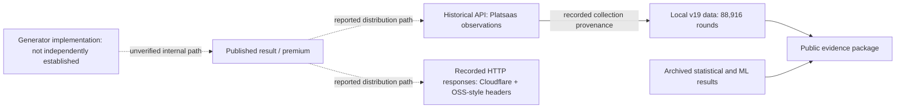

# WinGo 30S: an empirical audit of prediction claims

**88,916 recorded rounds · 31 calendar dates · preserved experiments · reproducible evidence checks**

This repository consolidates Saksham Chopra's WinGo 30S research: historical draw data, statistical diagnostics, trained-model evaluation records, and observations about result distribution infrastructure. It documents what the existing experiments establish—and where the evidence stops.

**The evaluated models did not establish a reliable predictive advantage. No generator seed was recovered.** This is a research archive, not a prediction service, a certification of the operator, or a proof that every possible attack fails.

The current dataset is complete across its recorded interval. Earlier analyses used different snapshots; their metrics are kept separate. No models were retrained and no game endpoints were contacted during publication preparation.

## Start here

- [Original Colour AI workspace](colour-ai/README.md) and [complete project ZIP with all 12 saved models](https://github.com/choprasaksham2007-a11y/wingo-prng-cryptanalysis/releases/download/v1.1.0/colour-ai-workspace.zip).
- [Full v19 datasets and workbook](https://github.com/choprasaksham2007-a11y/wingo-prng-cryptanalysis/releases/tag/v1.0.0).

- [Full whitepaper](docs/WHITEPAPER.md): research questions, mathematical arguments, findings and limitations.
- [Methods and reproduction](docs/METHODS.md): offline validation and optional archived-script replay.
- [Data provenance](docs/DATA_PROVENANCE.md): the 88,865 → 88,916 reconciliation.
- [Claim ledger](docs/CLAIM_LEDGER.md): corrections to the earlier “110-dimension” audit.
- [Saved models](models/README.md), [infrastructure evidence](docs/INFRASTRUCTURE.md), and [publication articles](articles/).

## The data

| Artifact | Records | Purpose |
|---|---:|---|
| `colour_raw_data_v19.csv` | 88,916 | Canonical completed rounds; nine columns |
| `Colour_Prediction_Dataset_v19.xlsx` | 88,916 raw + 88,911 ML | Seven-sheet master workbook |
| `colour_ml_ready_v19.csv` | 88,911 | Target plus five preceding rounds; 23 columns |
| [Repository sample](data/sample_1000_rounds.csv) | 1,000 | First 1,000 chronological rounds; seven allowlisted columns |
| `WinGo_same_time_every_day_legacy.csv` | 2,880 clock slots | Earlier comparison matrix containing 88,865 observations |

Full datasets are packaged as release assets; the small sample is committed to Git. Match downloads against [SHA-256 checksums](data/SHA256SUMS.txt). The sample illustrates the format and is **not** a random or representative sample for estimating full-corpus statistics.

Recorded timestamps run from **2026-10-12 00:00:00 to 2026-11-11 20:57:30**, without a gap in the current v19 data. These are the worksheet's clock values; their timezone is not independently established. Period IDs begin with a different date near some daily boundaries and must not be substituted for timestamps.

## One digit determines the displayed categories

| Digit | Size | Colour set |
|---|---|---|
| 0 | Small | Red + Violet |
| 1, 3 | Small | Green |
| 2, 4 | Small | Red |
| 5 | Big | Green + Violet |
| 6, 8 | Big | Red |
| 7, 9 | Big | Green |

Under independent, uniform digits, exact-digit accuracy has a 10% reference rate; Big/Small and primary Red/Green have 50%. Violet membership has probability 20%. The **four exact colour sets** have probabilities 40%, 40%, 10%, 10%; Violet overlaps the primary colours. These are different prediction tasks.

Every current full premium satisfies `int(premium) % 10 == number`. A premium is a **published result field**, not an identified RNG seed. If it is published after the draw, using it to predict that same draw is target leakage.

## Existing prediction results

| Source and target | Test rounds | Saved accuracy | Interpretation |
|---|---:|---:|---|
| VS Code, 1,000-feature model: exact digit | 5,000 | 8.76% | Below the 10% uniform reference |
| Same model: Big/Small | 5,000 | 48.26% | No demonstrated advantage |
| Same model: primary Red/Green | 5,000 | 49.52% | No demonstrated advantage |
| Same model: four exact colour sets | 5,000 | 39.02% | Separate task; 40% best fixed-class reference |
| Earlier ChatGPT report: 1-step transition | 17,762 | 10.40% | 95% interval 9.96–10.86%; no robust advantage established |
| Earlier ChatGPT report: random forest | 17,762 | 10.08% | Historical report; not rerun for this release |
| Antigravity saved random forest | 10,000 | 9.69% | Separate lag-five experiment |

The VS Code recent-100 Big/Small baseline reached **51.68%** on its 5,000-round exploratory backtest. That positive-looking result is retained, rather than hidden. The data had already been explored; it is not a prospective demonstration of a persistent edge. See [complete interpretation](docs/RESULTS_AND_LIMITATIONS.md) and [saved artifacts](docs/evidence/vscode/).

The “1,000 patterns” were **1,000 candidate input features**, not 1,000 discovered predictive laws. The publication does not infer that larger models, longer training, or more features guarantee 90% accuracy.

## Architecture: observations and uncertainty



The author's separate GitHub investigation identified `.NET System.Security.Cryptography.RandomNumberGenerator` backed by an OS CSPRNG as the working implementation finding. This release attributes that finding to the author (**REPORTED**). The supplied publication artifacts do not independently link an auditable implementation to the deployed generator. Matching nameservers, JSON error styles, entropy estimates, and CDN headers cannot establish that link on their own.

## Evidence status

**VERIFIED** means reproduced from the supplied local artifacts during publication checks, with scope specified. **REPORTED** means retained from earlier research without rerunning the experiment. **HYPOTHESIS** means a plausible but unestablished explanation. **UNKNOWN** means the required evidence is absent. None of these labels amounts to certification of the live platform.

The earlier “110-dimension” report is a research taxonomy, **not 110 independently validated cryptographic tests**. Some scripts set verdicts to constants, some use unsuitable bit encodings, and some saved outputs contradict the narrative. [The claim ledger](docs/CLAIM_LEDGER.md) documents these issues openly. Statistical tests cannot by themselves certify cryptographic security. [NIST SP 800-22](https://csrc.nist.gov/pubs/sp/800/22/r1/upd1/final)

## Run the offline checks

Python 3.11 or newer; the default command needs only the standard library:

```console
python scripts/run_audit_suite.py
python -m unittest discover -s tests -v
```

To check the full release downloads:

```console
python scripts/run_audit_suite.py --data data/colour_raw_data_v19.csv --ml data/colour_ml_ready_v19.csv
```

The default command checks integrity and summarizes saved evaluations. It does not retrain, deserialize weights, rerun statistical experiments, or contact a network. Archived analyses can be replayed explicitly; read [METHODS](docs/METHODS.md) first because their known defects are intentionally preserved for traceability.

## Credits, licensing and citation

Research and curation: **Saksham Chopra**. The archive combines the author's VS Code experiments, Google Antigravity-assisted analysis and dataset preparation, and ChatGPT-assisted analysis and publication engineering. AI assistance does not independently validate a claim.

Original project code and writing are provided under [MIT](LICENSE). [Third-party notices](THIRD_PARTY_NOTICES.md) describe dependencies, source boundaries, and dataset rights. The v1.1.0 workspace ZIP includes all 12 saved model files. Its [manifest](colour-ai/WORKSPACE_FILES.csv) identifies the distributed bytes, and the [original model inventory](models/manifest.csv) records the source hashes.

Use [CITATION.cff](CITATION.cff) to cite this release. Articles are provided as drafts for publication on [Medium/Substack](articles/medium_substack_post.md) and [LinkedIn](articles/linkedin_post.md).
