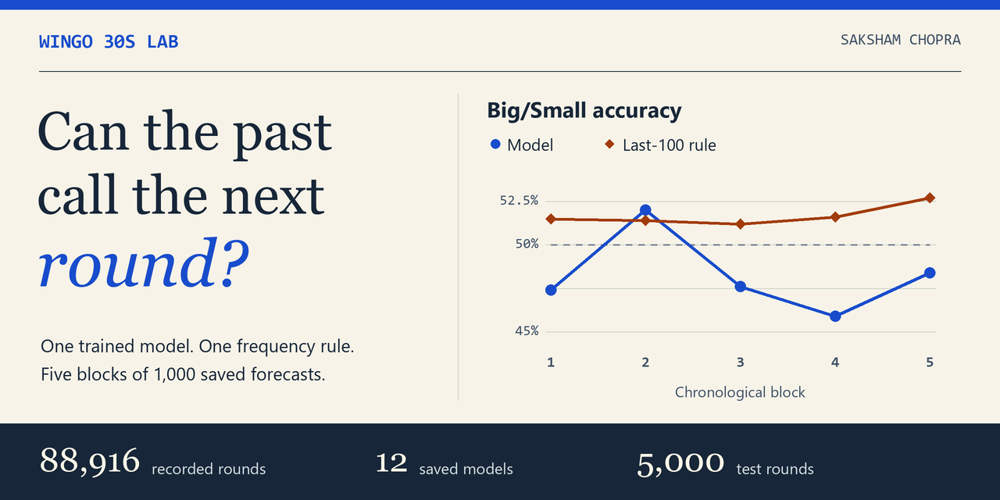
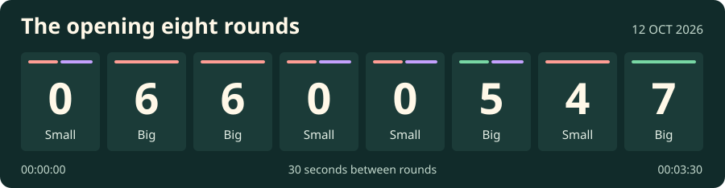

# WinGo 30S Lab

Research by **Saksham Chopra**.



**[Run the scorecard in Colab ↗](https://colab.research.google.com/github/choprasaksham2007-a11y/wingo-30s-lab/blob/main/examples/score-the-forecasts.ipynb)** · **[Download the VS Code project](https://github.com/choprasaksham2007-a11y/wingo-30s-lab/releases/download/v1.1.0/colour-ai-workspace.zip)** · **[Get the data](https://github.com/choprasaksham2007-a11y/wingo-30s-lab/releases/tag/v1.0.0)** · **[Read the paper](docs/WHITEPAPER.md)**

The model got **52%** of Big/Small calls right in its second block of 1,000 rounds. In the fourth, it got **45.9%**. Across all 5,000, a simple rule based on the previous 100 rounds beat the trained model by **171 correct calls**. This archive puts the forecasts, the underlying data and the scoring code in your hands.

I started with a question you can ask after watching a few rounds: if Big has just appeared five times, does knowing that streak help you call the sixth round? I collected outcomes, turned questions like this into model inputs, and saved individual forecasts so anyone could count the hits. The final dataset covers **88,916 rounds across 31 calendar dates**. The model evaluations below identify the particular snapshot each experiment used.

[Dataset guide](#inside-the-dataset) · [Forecast design](#how-the-forecasts-were-made) · [Scores](#how-did-the-model-score) · [Clock-time experiment](#does-the-same-digit-return-tomorrow) · [Generator evidence](#which-generator-does-the-research-point-to) · [Run the viewer](#open-the-saved-prediction-viewer) · [Verify the data](#check-the-archive-offline)

### Try it in two cells

Open the notebook and run both cells to score the saved digit, size and colour forecasts. Then set `start, stop = 1000, 2000` and rerun the second cell to see how much the headline accuracy changes when you choose a different window. The notebook runs with standard Python and verifies the prediction file's checksum. [Preview the scorecard and its output on GitHub](examples/score-the-forecasts.ipynb)

## Open the project

| What you want to do | Where to start |
| --- | --- |
| Run the app in VS Code | [Download the workspace ZIP](https://github.com/choprasaksham2007-a11y/wingo-30s-lab/releases/download/v1.1.0/colour-ai-workspace.zip), extract it and open the `colour-ai` folder. It contains all 12 saved models and the databases used by the viewer. |
| Record new rounds or view a prediction | Follow the [collector and viewer instructions](colour-ai/README.md). The viewer shows the digit, Big/Small, colour and estimated confidence. |
| Explore the complete dataset | [Raw CSV · 88,916 rounds](https://github.com/choprasaksham2007-a11y/wingo-30s-lab/releases/download/v1.0.0/colour_raw_data_v19.csv) or [Excel workbook · 7 sheets](https://github.com/choprasaksham2007-a11y/wingo-30s-lab/releases/download/v1.0.0/Colour_Prediction_Dataset_v19.xlsx). |
| Work with historical features | [ML CSV · 88,911 examples](https://github.com/choprasaksham2007-a11y/wingo-30s-lab/releases/download/v1.0.0/colour_ml_ready_v19.csv). Each target has five preceding rounds. |

## Inside the dataset

The final raw file runs from **October 12, 2026 at 00:00:00** to **November 11, 2026 at 20:57:30** in worksheet time. It contains one row per 30-second round throughout that interval. The timezone of the worksheet clock is unverified. Keep the 17-digit period ID as text when importing the CSV into a spreadsheet so the last digits survive the import.

| Field in the raw CSV | How to read it |
| --- | --- |
| `sequence_no`, `Period ID` | The first numbers the rows in order. The second identifies the game round and lets you look it up across files. |
| `timestamp` | The recorded worksheet time. Use it to compare the same clock slot on different dates. |
| `premium`, `number` | The published five-digit value and the winning digit. All 88,916 winning digits equal the last digit of their premium. |
| `colour`, `size` | The result labels derived from the winning digit. Violet can accompany either primary colour. |
| `colour_original`, `fix_note` | Fields retained in the full CSV for tracing corrections. The compact sample includes the first seven columns. |

The **ML file** has 88,911 examples. Each row lines up the target with the digit, colour and size from each of the **five preceding rounds**. The first five raw rounds supply the first example’s history. When constructing a predictor, keep the target premium out of its inputs. Reading its last digit would reveal the answer after publication. [Dataset guide](data/README.md) · [Schema and snapshot history](docs/DATA_PROVENANCE.md)

### How one digit defines four scoring targets

| Winning digit | Size | Primary colour | Full colour result |
| --- | --- | --- | --- |
| 0 | Small | Red | Red + Violet |
| 1, 3 | Small | Green | Green |
| 2, 4 | Small | Red | Red |
| 5 | Big | Green | Green + Violet |
| 6, 8 | Big | Red | Red |
| 7, 9 | Big | Green | Green |

For example, a primary-colour call of Green succeeds when the digit is 5. An exact-colour call of plain Green misses that same round because the result includes Violet. This distinction explains why the two colour columns in the scorecard have different accuracy rates.

## How the forecasts were made

The 1,000-feature experiment used an earlier historical snapshot. Its catalogue includes inputs for several concrete questions:

- **Does a streak carry information?** Big/Small, Green and Violet streak lengths describe the run that has already happened. Rolling frequencies also capture how common a label was across a longer window.
- **Does the order matter?** Lagged digits preserve which results appeared one, two or more rounds ago. Transition features describe how often particular digits followed earlier observations. Two windows with the same count of Big results can have very different sequences.
- **Does the round identifier matter?** Inputs include individual period digits and remainders of the round counter. These give the model a way to test repeating positions in the schedule.

Many inputs describe overlapping slices of the same history. For example, after a long Big streak, both the streak length and the recent Big frequency rise. The evidence for a useful pattern comes from the later forecasts it gets right. [Browse all 1,000 feature names](docs/evidence/vscode/thousand_feature_catalog.json)

| Stage, in time order | Examples | What happened |
| --- | ---: | --- |
| Training | 4,096 | Fit the candidate models on earlier rounds. |
| Selection | 1,500 | Choose architectures, probability calibration and model weights on the next group. |
| Evaluation | 5,000 | Freeze those choices and record one set of predictions per eligible round. |

As each test round finished, its outcome became available as history for later forecasts. The fitted weights stayed fixed throughout the test. A gap reset the input history, and a forecast required at least 20 consecutive prior observations. The saved protocol records the cutoff periods and a checksum for the source snapshot. [Evaluation protocol](docs/evidence/vscode/thousand_protocol.json) · [Model inventory](models/README.md)

## How did the model score?

These counts come from the individual forecast rows. The reference rates assume independent, uniformly distributed digits.

| Prediction | Correct out of 5,000 | Accuracy | Reference rate |
| --- | ---: | ---: | ---: |
| Exact digit (0–9) | 438 | 8.76% | 10% |
| Big or Small | 2,413 | 48.26% | 50% |
| Primary colour (Red or Green) | 2,476 | 49.52% | 50% |
| Full colour set, including Violet | 1,951 | 39.02% | 40% for the most common single class |

The recent-100 Big/Small rule got **2,584/5,000 (51.68%)** right. These rounds had already been explored. Establishing a lasting advantage would require recording predictions on fresh rounds before the outcomes arrive. [Saved predictions](docs/evidence/vscode/thousand_test_predictions_5000.csv) · [Results and limitations](docs/RESULTS_AND_LIMITATIONS.md)

### Read a forecast and check the outcome

Take period `20261026100051341`, the first row of the test. The model’s exact-digit pick was **1**, with an estimated probability of **10.30%**. Its size pick was **Big**, at **52.46%**. The actual digit was **4**, which is Small, so both calls missed. The confidence columns record what the model estimated at prediction time. Accuracy is calculated afterward by counting correct calls across the selected rows. [Inspect the prediction CSV](docs/evidence/vscode/thousand_test_predictions_5000.csv)

### Does the same digit return tomorrow?

I compared the same 30-second clock slot on adjacent calendar dates in the earlier snapshot. The winning digit repeated in **8,700 of 85,985 pairs (10.12%)**. Among the **85,936 pairs** with a complete five-digit premium on both dates, the complete premium repeated **three times**. Empty cells break a pair, so a gap never turns a two-day interval into a one-day comparison. [Download the clock-time matrix and reproduce the count](docs/DATA_PROVENANCE.md#did-yesterdays-result-repeat-at-the-same-clock-time)

An earlier experiment also tried predicting the next digit from the previous one. Its one-step transition model scored **10.40% on 17,762 later examples**, with a reported 95% interval of **9.96% to 10.86%**. That interval includes the 10% reference rate. This result belongs to a separate experiment with a different test period and denominator. [Earlier prediction report](docs/evidence/chatgpt/premium_analysis_2026-11-11.md)

<details>
<summary><strong>Read one round of the dataset</strong></summary>



At the worksheet time **00:00:00**, the first published premium was **71180**. Its last digit, **0**, makes the result **Small** and **Red + Violet**. All **88,916** completed records follow that last-digit rule. A forecast must be recorded before the target round’s premium becomes available. [Inspect the first 1,000 rows](data/sample_1000_rounds.csv)

</details>

## Explore the research

- **Models and forecasts.** Explore the training code, collectors and live viewer, or inspect the checkpoints behind the saved forecasts. [Browse the app](colour-ai/) · [Model inventory](models/README.md)
- **Round history.** I compared an earlier snapshot of 88,865 rounds with the final dataset. I found 51 added rounds and 49 previously incomplete premiums. Every winning digit present in both snapshots agreed. [Compare the snapshots](docs/DATA_PROVENANCE.md) · [Same-time digit repeat analysis](docs/DATA_PROVENANCE.md#did-yesterdays-result-repeat-at-the-same-clock-time) · [Earlier report](docs/evidence/chatgpt/premium_analysis_2026-11-11.md)
- **Audit trail.** Follow the workbook revisions and image-based digit checks. My review of the original 110-dimension audit identified hardcoded verdicts and tests whose assumptions did not fit the data. [Browse the audit archive](antigravity/README.md) · [Read the corrections](docs/CLAIM_LEDGER.md)

## Which generator does the research point to?

My investigation points to **Microsoft .NET’s `System.Security.Cryptography.RandomNumberGenerator`**, backed by the operating system’s cryptographically secure pseudorandom number generator (CSPRNG). Microsoft documents that the static methods of this .NET class draw randomness from the platform. Identifying the exact algorithm used on the WinGo server would require evidence of its deployed implementation. [Microsoft’s .NET cryptography documentation](https://learn.microsoft.com/en-us/dotnet/standard/security/cryptography-model#one-shot-apis) · [Implementation evidence](docs/INFRASTRUCTURE.md#framework-and-implementation-claims)

The 88,916 rounds verify one step readers can check directly: the published winning digit equals the last digit of the premium. Several different generators could produce outputs with that property. The saved HTTP headers describe how finished results reached clients. The server’s underlying algorithm, seed and reseeding policy remain unknown. [Evidence for each claim](docs/CLAIM_LEDGER.md)

## Check the archive offline

From the repository root, run the following with Python 3.11 or newer. The command checks the sample’s period sequence, timestamps and digit mappings, then verifies the historical evidence manifest. It uses the Python standard library.

```console
python scripts/run_audit_suite.py
```

A successful sample run reports **1,000 rows and 1,000 unique periods**. Open `outputs/publication_checks.json` for the detailed results. To validate the full release, download the raw and ML CSVs into `data/` under their original names, then run:

```console
python scripts/run_audit_suite.py --data data/colour_raw_data_v19.csv --ml data/colour_ml_ready_v19.csv
```

This second command also checks that every ML target lines up with the right raw round and that all five sets of historical labels match their source rows. It catches a one-row shift even when the individual values still look plausible.

[Full-data verification instructions](docs/METHODS.md) · [Dataset checksums](data/SHA256SUMS.txt) · [Workspace file manifest](colour-ai/WORKSPACE_FILES.csv)

## Open the saved prediction viewer

Download and extract the workspace from the **v1.1.0 release**, then open PowerShell in its `colour-ai` folder. The workspace used Python 3.14. These commands install its dependencies and display the saved prediction once:

```powershell
py -3.14 -m venv .venv
.\.venv\Scripts\python.exe -m pip install -r requirements.txt
.\.venv\Scripts\python.exe src\view_live.py --once
```

Read the period ID and timestamp alongside the picks. Opening the saved database shows forecasts from the archived session. To record **new** forecasts, the collector must receive current results and the prediction worker must be running. The workspace guide gives the two commands and the location of the resulting history file. [Download the workspace](https://github.com/choprasaksham2007-a11y/wingo-30s-lab/releases/tag/v1.1.0) · [Collector and viewer guide](colour-ai/README.md)

## Citation and reuse

[Long-form article](articles/medium_substack_post.md) · [LinkedIn draft](articles/linkedin_post.md) · [Citation](CITATION.cff) · [License](LICENSE) · [Data and third-party notices](THIRD_PARTY_NOTICES.md)

If you use the dataset or notebook, star the repository to save it for your next experiment. If you find a discrepancy, include the period ID, the snapshot you used and the value you expected. [Report a data or scoring issue](https://github.com/choprasaksham2007-a11y/wingo-30s-lab/issues)
