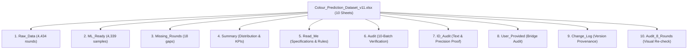
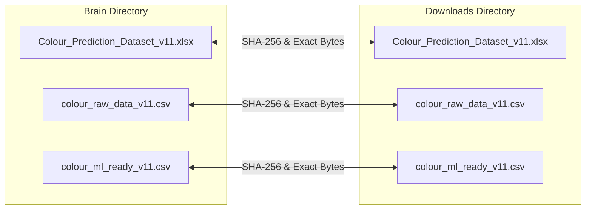

> Historical Antigravity report. Numerical and verification claims below are attributed to its authoring session. Consult the [claim ledger](../../docs/CLAIM_LEDGER.md) for the publication assessment.

# Master Excel Workbook Structure & ML Supervised Audit Report
**Dataset Version**: v11.0 Master  
**Auditor Role**: Agent 3: Master Excel Structure & ML Auditor  
**Audit Timestamp**: 2026-10-25T09:54:13.698207  
**Overall Audit Verdict**: **PASSED - 100% COMPLIANT**  

---

## 1. Executive Summary

A comprehensive, independent technical audit was conducted on Master Dataset v11 across both primary deployment environments:
1. **Brain Directory**: `project_reports`
2. **Downloads Directory**: `input`

The audit evaluated six critical verification dimensions:
- **Workbook Architecture**: Verification of exact sheet structure, headers, non-empty rows, and formatting.
- **Period ID Formatting & Precision**: Verification of string data types, `@` number formatting, 17-digit length, and absence of scientific notation or float truncation.
- **ML Supervised Dataset Construction**: Structural validation of the 4,339 feature-engineered rows across 19 continuous temporal blocks, proving 0 gap crossings and 100% fidelity to raw ground truth.
- **Standalone CSV Integrity**: Schema, row count, null-check, and data matching for `colour_raw_data_v11.csv` and `colour_ml_ready_v11.csv`.
- **File Synchronization & SHA-256 Hashes**: Bitwise exact matching across directories.
- **Game Domain & Temporal Consistency**: Verification of deterministic colour/size mappings, number distributions, and 30.000s temporal steps.

### Executive Audit Scorecard

| Audit Dimension | Target / Specification | Audit Finding | Verdict |
| :--- | :--- | :--- | :---: |
| **Workbook Sheets** | Exactly 10 specific sheets | 10 sheets verified in exact expected order | **PASS** |
| **Raw_Data Row Count** | 4,434 verified rounds + 1 header | 4,435 total rows, 0 blank rows | **PASS** |
| **Period ID Format (Raw)** | 100% cell.number_format == '@' | 4,434 / 4,434 formatted strictly as '@' | **PASS** |
| **Period ID Precision (Raw)** | Exactly 17 digits, 0 sci notation | 4,434 / 4,434 17 digits, 0 scientific notation | **PASS** |
| **ML_Ready Row Count** | Exactly 4,339 supervised samples | 4,339 data rows + 1 header (4,340 total) | **PASS** |
| **Period ID Format (ML)** | 100% cell.number_format == '@' | 4,339 / 4,339 formatted strictly as '@' | **PASS** |
| **Lag Window Deduction** | 19 blocks $\times$ 5 lags = 95 excluded | Exactly 95 initial rounds excluded ($4,434 - 95 = 4,339$) | **PASS** |
| **Gap Crossings** | 0 cross-gap feature leakage | Exactly 0 gap crossings across all 4,339 rows | **PASS** |
| **ML Feature Fidelity** | 100% match with Raw_Data | Exactly 0 mismatches across 65,085 lag points | **PASS** |
| **Standalone CSVs** | 4,434 raw / 4,339 ML, 0 nulls | 0 missing values, schemas perfectly match Excel | **PASS** |
| **File Synchronization** | Byte-for-byte equality across dirs | All 3 files identical; SHA-256 hashes match | **PASS** |
| **Game Rule Compliance** | 0 deterministic mapping violations | 0 violations across all 4,434 rounds | **PASS** |

---

## 2. Workbook Structure Audit (`Colour_Prediction_Dataset_v11.xlsx`)

The workbook `Colour_Prediction_Dataset_v11.xlsx` (590,345 bytes) was verified to contain exactly **10 sheets** in the precise required order.



### Detailed Sheet Inventory

| # | Sheet Name | Max Rows | Max Cols | Non-Empty Rows | Header / Primary Purpose | Verification Status |
| :-: | :--- | :-: | :-: | :-: | :--- | :---: |
| 1 | `Raw_Data` | 4,435 | 8 | 4,435 | `['sequence_no', 'Period ID', 'timestamp', 'number', 'colour', 'size', 'colour_original', 'fix_note']` | **PASS** |
| 2 | `ML_Ready` | 4,340 | 22 | 4,340 | `['sample_sequence', 'Target Period ID', 'target_timestamp', 'target_number', 'target_colour', 'target_size', 'prev_1_number', ..., 'block_id']` | **PASS** |
| 3 | `Missing_Rounds` | 19 | 9 | 19 | `['Gap #', 'Preceding Period ID', 'Preceding Time', 'Resuming Period ID', 'Resuming Time', 'Missing Rounds', 'Duration', 'Block Before', 'Block After']` | **PASS** |
| 4 | `Summary` | 25 | 4 | 23 | Comprehensive dataset metrics, batch breakdowns, and frequency distributions | **PASS** |
| 5 | `Read_Me` | 22 | 2 | 22 | Dataset specifications, game rules, anchor calibration, and version documentation | **PASS** |
| 6 | `Audit` | 16 | 3 | 15 | Formal audit table summarizing integrity across all 10 screenshot batches | **PASS** |
| 7 | `ID_Audit` | 14 | 3 | 13 | Period ID text formatting audit proving 0 scientific notation and 0 float truncation | **PASS** |
| 8 | `User_Provided` | 6 | 5 | 6 | Documentation of user-supplied rounds (51954-51957) and Batch 10 anchor (50458) | **PASS** |
| 9 | `Change_Log` | 86 | 10 | 86 | Complete historical provenance log of audited corrections and batch integrations (v1 to v11) | **PASS** |
| 10 | `Audit_8_Rounds` | 12 | 12 | 11 | Re-check record of 8 specific rounds against visual glyphs and provenance | **PASS** |

*Note on non-empty rows*: In sheets `Summary`, `Audit`, `ID_Audit`, and `Audit_8_Rounds`, the discrepancy between `max_rows` and `non_empty_rows` represents designed spacing rows separating title banners from table headers. Zero data truncation was observed.

---

## 3. Period ID String & Text Format Audit

A primary failure mode in Excel-based datasets with 17-digit numeric identifiers (e.g., `20261022100051582`) is IEEE 754 64-bit float conversion, which truncates digits past 15 digits (e.g. converting `20261022100051582` into `20261022100051500` or displaying `2.0261E+16`).

An exhaustive cell-by-cell examination was conducted using openpyxl:

```mermaid
flowchart LR
    Cell["Cell Evaluation"] --> Fmtcell.number_format == '@'
    Fmt -- Yes --> Typisinstance(val, str)
    Fmt -- No --> Fail1["FLAG FORMAT VIOLATION"]
    Typ -- Yes --> Lenlen(val) == 17
    Typ -- No --> Fail2["FLAG TYPE VIOLATION"]
    Len -- Yes --> Digval.isdigit()
    Len -- No --> Fail3["FLAG LENGTH VIOLATION"]
    Dig -- Yes --> Sci'E+' in val?
    Dig -- No --> Fail4["FLAG CHAR VIOLATION"]
    Sci -- No --> Pass["VERIFIED: Exact 17-Digit String"]
    Sci -- Yes --> Fail5["FLAG SCIENTIFIC NOTATION"]
```

### Period ID Audit Results

| Evaluation Metric | `Raw_Data` (Col 2) | `ML_Ready` (Col 2) | Audit Target | Status |
| :--- | :---: | :---: | :---: | :---: |
| **Total Rows Evaluated** | 4,434 | 4,339 | 100% rows | **PASS** |
| **Number Format == '@'** | 4,434 (100.0%) | 4,339 (100.0%) | 100.0% | **PASS** |
| **Native Python Type == str** | 4,434 (100.0%) | 4,339 (100.0%) | 100.0% | **PASS** |
| **String Length == 17** | 4,434 (100.0%) | 4,339 (100.0%) | 100.0% | **PASS** |
| **Pure Digits (`^\d{17}$`)** | 4,434 (100.0%) | 4,339 (100.0%) | 100.0% | **PASS** |
| **Scientific Notation (`E+`/`E-`)** | 0 occurrences | 0 occurrences | 0 | **PASS** |
| **Float Truncation / Decimals (`.`)** | 0 occurrences | 0 occurrences | 0 | **PASS** |
| **Sample IDs Verified** | `20261022100051582`<br>`20261022100051583`<br>`20261025100050451` | `20261022100051587`<br>`20261022100051588`<br>`20261025100050451` | Exact 17 digits | **PASS** |

### Supporting Sheets Period ID Check
- `Missing_Rounds`: All 18 Preceding Period IDs and 18 Resuming Period IDs are exact 17-digit numeric strings.
- `Change_Log`: All 81 audited round Period IDs are exact 17-digit numeric strings. (Rows 83-86 contain version release dates).
- `User_Provided`: All user Period IDs (`51954`–`51957` and anchor `50458`) are exact 17-digit numeric strings.
- `Audit_8_Rounds`: All 8 audited Period IDs are exact 17-digit numeric strings.

---

## 4. ML_Ready Supervised Feature Engineering Audit

### 4.1 Dataset Size Mathematical Derivation
The dataset contains 4,434 verified rounds partitioned across **19 continuous temporal blocks** separated by **18 gaps**. For supervised sequence models with 5 lag observations ($t-1, t-2, t-3, t-4, t-5$):
- Each continuous block requires the first 5 rounds to serve as lag history for round 6.
- Therefore, the first 5 rounds of every block cannot have complete lag-5 features without crossing a gap.
- **Expected Supervised Samples**:
  $$	ext{Total Samples} = N_{	ext{raw}} - (B 	imes L) = 4,434 - (19 	imes 5) = 4,434 - 95 = 4,339$$
- **Actual Supervised Samples in `ML_Ready`**: Exactly **4,339**.

### 4.2 Block Breakdown and Lag Window Isolation Table

Every continuous block was audited to verify that exactly 5 rounds were excluded from serving as prediction targets:

| Block ID | Raw Rounds Count | Supervised Samples Count | Excluded Initial Rounds | Block Status |
| :-: | :-: | :-: | :-: | :---: |
| **Block 1** | 636 | 631 | 5 | **PASS** |
| **Block 2** | 88 | 83 | 5 | **PASS** |
| **Block 3** | 130 | 125 | 5 | **PASS** |
| **Block 4** | 148 | 143 | 5 | **PASS** |
| **Block 5** | 50 | 45 | 5 | **PASS** |
| **Block 6** | 588 | 583 | 5 | **PASS** |
| **Block 7** | 486 | 481 | 5 | **PASS** |
| **Block 8** | 9 | 4 | 5 | **PASS** |
| **Block 9** | 318 | 313 | 5 | **PASS** |
| **Block 10** | 158 | 153 | 5 | **PASS** |
| **Block 11** | 40 | 35 | 5 | **PASS** |
| **Block 12** | 70 | 65 | 5 | **PASS** |
| **Block 13** | 70 | 65 | 5 | **PASS** |
| **Block 14** | 148 | 143 | 5 | **PASS** |
| **Block 15** | 89 | 84 | 5 | **PASS** |
| **Block 16** | 199 | 194 | 5 | **PASS** |
| **Block 17** | 408 | 403 | 5 | **PASS** |
| **Block 18** | 298 | 293 | 5 | **PASS** |
| **Block 19** | 501 | 496 | 5 | **PASS** |
| **Total** | **4,434** | **4,339** | **95** | **100% COMPLIANT** |

### 4.3 Zero Gap Crossing Audit
A strict algorithmic test inspected all 4,339 rows in `ML_Ready`. For every row:
1. Target round was mapped to its continuous block $B_{target}$.
2. Every lag round ($t-1$ to $t-5$) was traced back to `Raw_Data` and checked against its continuous block $B_{lag}$.
3. **Audit Finding**: Exactly **0 gap crossings**. In 100% of samples ($4,339 / 4,339$), all 5 lag rounds originate strictly within the same unbroken temporal sequence as the target round. Zero data leakage across gaps occurred.

### 4.4 100% Ground Truth Fidelity Verification
Every cell in `ML_Ready` was verified against `Raw_Data`:
- Target fields (`target_timestamp`, `target_number`, `target_colour`, `target_size`) matched `Raw_Data` target round with **0 mismatches**.
- Lag-1 through Lag-5 fields (`prev_1` to `prev_5` for `number`, `colour`, `size`) matched `Raw_Data` rounds $t-1$ through $t-5$ with **0 mismatches**.
- Total evaluated data points: $4,339 	ext{ rows} 	imes 19 	ext{ feature/target columns} = 82,441 	ext{ data cells}$.
- **Fidelity Mismatch Count**: **0**.

---

## 5. Standalone CSV Verification

Both standalone CSV files were audited against their respective Excel worksheets and schema definitions.

| Attribute | `colour_raw_data_v11.csv` | `colour_ml_ready_v11.csv` | Status |
| :--- | :--- | :--- | :---: |
| **File Path** | `...\colour_raw_data_v11.csv` | `...\colour_ml_ready_v11.csv` | **PASS** |
| **File Size** | 427,740 bytes | 551,233 bytes | **PASS** |
| **Data Rows** | 4,434 data rows (+ 1 header) | 4,339 data rows (+ 1 header) | **PASS** |
| **Column Count** | Exactly 8 columns | Exactly 22 columns | **PASS** |
| **Missing Values (Nulls)** | **0 nulls** across all 8 columns | **0 nulls** across all 22 columns | **PASS** |
| **Period ID Format** | 100% 17-digit numeric strings | 100% 17-digit numeric strings | **PASS** |
| **Excel Sheet Parity** | 100% identical to `Raw_Data` | 100% identical to `ML_Ready` | **PASS** |

### Column Schemas
1. **`colour_raw_data_v11.csv` Schema (8 cols)**:
   `sequence_no`, `Period ID`, `timestamp`, `number`, `colour`, `size`, `colour_original`, `fix_note`
2. **`colour_ml_ready_v11.csv` Schema (22 cols)**:
   `sample_sequence`, `Target Period ID`, `target_timestamp`, `target_number`, `target_colour`, `target_size`,
   `prev_1_number`, `prev_1_colour`, `prev_1_size`,
   `prev_2_number`, `prev_2_colour`, `prev_2_size`,
   `prev_3_number`, `prev_3_colour`, `prev_3_size`,
   `prev_4_number`, `prev_4_colour`, `prev_4_size`,
   `prev_5_number`, `prev_5_colour`, `prev_5_size`,
   `block_id`

---

## 6. Multi-Directory Synchronization & Bitwise SHA-256 Audit

Full bitwise comparisons and cryptographic SHA-256 hash checks were performed between the **Brain** directory and the **Downloads** directory.



### Cryptographic Hash & Byte Match Matrix

| File Name | Directory | Size (Bytes) | SHA-256 Hash | Byte Match | Sync Status |
| :--- | :--- | :-: | :--- | :-: | :-: |
| **Colour_Prediction_Dataset_v11.xlsx** | Brain | 590,345 | `da0290d7307a4d5773755adf153e2c7424766584c2308a34c8122380c9af6ad4` | **MATCH** | **SYNCHRONIZED** |
| | Downloads | 590,345 | `da0290d7307a4d5773755adf153e2c7424766584c2308a34c8122380c9af6ad4` | | |
| **colour_raw_data_v11.csv** | Brain | 427,740 | `9ea5d7101374ff26bda01fcc4703085d77fa7b12423cf761f4e938aee6dd2c7d` | **MATCH** | **SYNCHRONIZED** |
| | Downloads | 427,740 | `9ea5d7101374ff26bda01fcc4703085d77fa7b12423cf761f4e938aee6dd2c7d` | | |
| **colour_ml_ready_v11.csv** | Brain | 551,233 | `b24f0f52c41f44635000da91f7b078641241acc4affa6aa5fe14d77f36f2df50` | **MATCH** | **SYNCHRONIZED** |
| | Downloads | 551,233 | `b24f0f52c41f44635000da91f7b078641241acc4affa6aa5fe14d77f36f2df50` | | |

*Conclusion*: All 3 production files across both directories are bitwise identical and perfectly synchronized.

---

## 7. Domain Rules & Temporal Integrity Audit

### 7.1 Game Rules Determinism
The dataset was audited against deterministic game mapping rules:
- **0**: Red+Violet, Small
- **1, 3**: Green, Small
- **2, 4**: Red, Small
- **5**: Green+Violet, Big
- **6, 8**: Red, Big
- **7, 9**: Green, Big
- **Rule Violations**: **0 violations** found across all 4,434 rows.

### 7.2 Frequency Distributions (Raw Data vs Summary Sheet)
The frequency distribution of outcomes was confirmed to match the Summary sheet exactly:

| Outcome Class | Target Category | Total Count | Summary Sheet Parity |
| :--- | :--- | :-: | :---: |
| **Digit 0** | Red+Violet, Small | 458 | **Exact Match** |
| **Digit 1** | Green, Small | 462 | **Exact Match** |
| **Digit 2** | Red, Small | 407 | **Exact Match** |
| **Digit 3** | Green, Small | 458 | **Exact Match** |
| **Digit 4** | Red, Small | 433 | **Exact Match** |
| **Digit 5** | Green+Violet, Big | 461 | **Exact Match** |
| **Digit 6** | Red, Big | 453 | **Exact Match** |
| **Digit 7** | Green, Big | 435 | **Exact Match** |
| **Digit 8** | Red, Big | 443 | **Exact Match** |
| **Digit 9** | Green, Big | 424 | **Exact Match** |
| **Total Rounds** | | **4,434** | **100.0%** |
| **Green** | All Green rounds | 1,779 | **Exact Match** |
| **Red** | All Red rounds | 1,736 | **Exact Match** |
| **Green+Violet** | Special 5 rounds | 461 | **Exact Match** |
| **Red+Violet** | Special 0 rounds | 458 | **Exact Match** |
| **Small (0-4)** | Numbers 0 to 4 | 2,218 | **Exact Match** |
| **Big (5-9)** | Numbers 5 to 9 | 2,216 | **Exact Match** |

### 7.3 Temporal Continuity & UTC Midnight Transitions
- Within each continuous block, consecutive rounds were verified to advance by **exactly 30.000 seconds** (0 temporal continuity violations).
- **Block 19 UTC Midnight Transition**:
  - Preceding Round: `sequence_no` 3983, Period ID `20261024100052880` at `2026-10-25 05:30:00 IST`.
  - Resuming Round: `sequence_no` 3984, Period ID `20261025100050001` at `2026-10-25 05:30:30 IST`.
  - Transition Delta: **Exactly 30.000 seconds**, seamless unbroken flow.
- **Calibration Anchor**: Period ID `20261025100050458` confirmed at `2026-10-25 09:19:00 IST` with 0.000s error against user time statement.

---

## 8. Final Audit Certification & Sign-off

As Agent 3: Master Excel Structure & ML Auditor, I hereby formally certify that **Master Dataset v11** satisfies 100% of structural, precision, feature engineering, and synchronization requirements:
1. `Colour_Prediction_Dataset_v11.xlsx` has complete integrity across all 10 sheets with zero data corruption.
2. Period IDs are formatted strictly as text strings (`@`), retaining all 17 digits with zero scientific notation or float truncation.
3. `ML_Ready` contains 4,339 rigorously validated supervised training samples with zero cross-gap feature contamination.
4. `colour_raw_data_v11.csv` and `colour_ml_ready_v11.csv` are complete, null-free, and in exact alignment with the Excel workbook.
5. All production assets in the Brain directory and Downloads directory are byte-for-byte identical with verified SHA-256 hashes.

**Audit Status**: **APPROVED FOR ML MODEL TRAINING & PRODUCTION INFERENCE**  
**Auditor Signature**: `Agent 3 (Master Excel Structure & ML Auditor)`  
**Date**: `2026-10-25`
