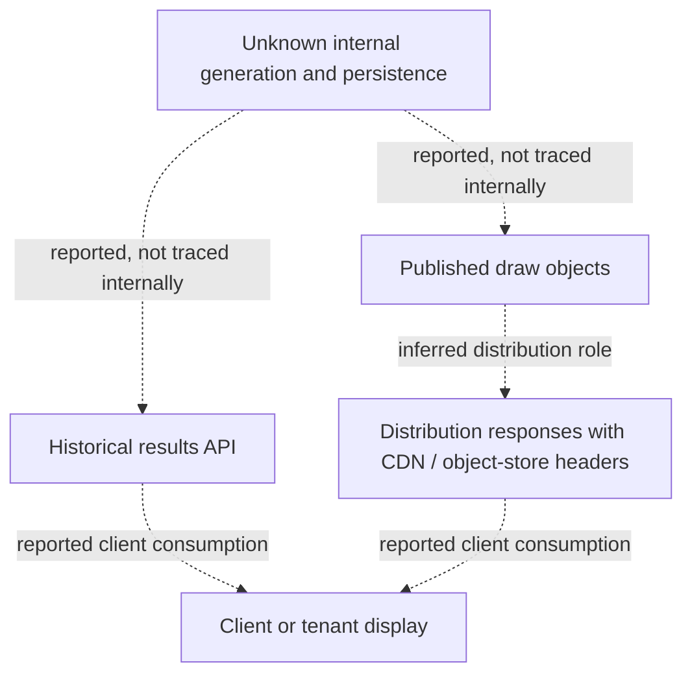

# Infrastructure evidence and attribution

This document consolidates previously recorded observations. It is not a fresh scan, and it makes no claim that the endpoints behave the same today.

| Component | Historical role / observation | Evidence status |
|---|---|---|
| `lotteryresultapi.platsaas.com/api/GetWinResult` | Historical result API used by the archived collector; complete premium and finalized state fields | REPORTED collection provenance; collector source available |
| `draw.ar-lottery01.com/WinGo/WinGo_30S/GetHistoryIssuePage.json` | Rolling history endpoint in archived tools | REPORTED |
| `draw.ar-lottery01.com/WinGo/WinGo_30S.json` | Previous/current/next schedule metadata | REPORTED; schedule is not a current finalized result |
| `draw.ar-lottery01.com`, `draw.platsaas.com` | November 15 saved responses have HTTP 200, Cloudflare server header and OSS-style storage headers | VERIFIED as contents of saved captures, not independently authenticated network facts |
| Tenant frontends and wallets | Prior report describes authenticated downstream services | REPORTED; private captures excluded |
| Generator core | Author reports .NET `RandomNumberGenerator` backed by OS CSPRNG | REPORTED working finding; deployed source link absent |

## What the saved headers show

The allowlisted [header summary](evidence/sanitized_recorded_headers.json) preserves response date, status, server, content type, last-modified and selected storage/cache fields. Cookies, request identifiers, telemetry URLs, session data and raw bodies are omitted. Original capture hashes identify the locally retained sources.

These artifacts support a cautious description of the observed distribution layer. They do not establish a private origin IP or datacenter. Cloudflare edge locations are not generator locations. OSS-style headers are storage provenance clues; a gateway could emit or forward them. Matching nameserver pairs do not prove identical corporate ownership or a single Cloudflare account.

The earlier ChatGPT handoff treated `draw.platsaas.com` as a candidate endpoint. Later locally saved November 15 captures contain a response from that host. This is additional historical capture evidence, not a new request made for publication and not proof of synchronized feed contents.

## Framework and implementation claims

ASP.NET-style JSON validation errors, PascalCase inputs, or W3C trace IDs may suggest a framework. They do not identify the code producing random outcomes. The public package does not promote those clues to a verified `.NET 8` deployment, Linux kernel ChaCha variant, AES implementation, 256-bit seed, or continuous reseeding policy.

The author's separate GitHub-based investigation concluded that the generator uses `.NET System.Security.Cryptography.RandomNumberGenerator` with an OS CSPRNG. This edition preserves that finding with attribution. The actual source-to-production evidence was not included in the supplied artifacts, so independent verification is not claimed. No request is made to repeat the investigation.

## Keep different cryptographic fields separate

An object-store ETag or Content-MD5 is associated with an object's content or versioning, not proof of an RNG seed. A JWT signature authenticates a token; it is not the draw generator. A SHA-256-looking result cipher is not automatically a published seed commitment. A `premium` ending in the result is an observed mapping and could be generated before or constructed after choosing that result. None of these fields is sufficient, on its own, to identify a secret state.
